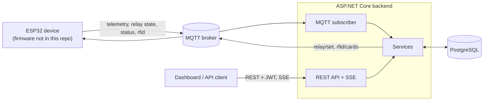

# IoT Monitoring and Control Backend

[](https://dotnet.microsoft.com/)
[](https://learn.microsoft.com/aspnet/core)
[](https://learn.microsoft.com/dotnet/csharp/)
[](https://www.postgresql.org/)
[](https://mqtt.org/)
[](https://www.docker.com/)
[](https://xunit.net/)

ASP.NET Core backend for an IoT monitoring-and-control proof of concept. An ESP32 publishes
electrical measurements (PZEM-004T), relay state and RFID scans over MQTT; the backend persists
them in PostgreSQL, exposes a REST API and a Server-Sent Events stream for a dashboard, and sends
relay ON/OFF commands back to the device while tracking whether the device acknowledged them.

> **Status:** curated portfolio version of an internship proof of concept. It was exercised with
> simulated devices in this repository, not deployed as a production system. See
> [Known limitations](#known-limitations).

## Key Features

- **MQTT device integration:** telemetry, relay state, status and RFID scans, with automatic
  reconnect and re-subscribe.
- **Relay commands with acknowledgement tracking:** every command has its own lifecycle and ends as
  `executed`, `failed` or `timeout`.
- **Device availability:** explicit `online`/`offline` status messages plus an inactivity sweep.
- **PostgreSQL-backed REST API:** devices, latest state, telemetry history, command history, JWT
  authentication (one shared account).
- **RFID whitelist management:** edited through the API, published to devices as a retained MQTT message.
- **Live updates and tests:** one SSE stream for the dashboard, and an xUnit suite that includes an
  end-to-end test against an in-process MQTT broker (no hardware needed).

## System Architecture



HTTP and MQTT both call the same service classes, so business rules live in one place. Dependency
injection lifecycles, the full command sequence, state transitions, availability logic and the
database model: [`docs/architecture.md`](docs/architecture.md).

## Tech Stack

| Area | Technology |
|---|---|
| Runtime / API | .NET 10, ASP.NET Core controllers, OpenAPI + Scalar UI (Development only) |
| Messaging | MQTTnet 5 (TLS by default; TLS can be disabled for a local broker only) |
| Database | PostgreSQL via Npgsql + Dapper, hand-written parameterised SQL, no EF Core |
| Auth | JWT bearer (HS256); password hash from ASP.NET Core Identity's `PasswordHasher` |
| Realtime | Server-Sent Events from an in-memory broadcaster |
| Tests | xUnit, `WebApplicationFactory`, in-process MQTTnet broker, real PostgreSQL |
| Packaging | Docker (multi-stage, non-root image) and Docker Compose |

## Engineering Highlights

**1. Command intent vs. device-reported state.** Publishing `relay/set` only shows the backend
handed a message to the broker; it does not show the device received or executed it. A command is
marked `executed` only after the device acknowledges it and reports a relay state with the same
`commandId`. The backend knows what the firmware *reports*; it does not independently measure the
physical relay contact. For the same reason `POST /api/devices/{id}/relay` returns
`202 Accepted`, which means the request was accepted and recorded, not that it was delivered,
executed, or that the reported state equals the requested one.

**2. A race found during portfolio refinement.** Regression testing identified a race: the command
is published *before* its row is marked `sent`, so a fast device acknowledgement could be
overwritten by the delayed `sent` update, after which the command timed out. The transition is now
guarded in SQL (`pending → sent` only). In the validation phase, four tests in the 18-test
lifecycle suite failed against the original statement and all passed with the fix.

**3. MQTT integration and lifecycle design.** The subscriber is a singleton hosted service while
repositories and services are scoped, so it opens a DI scope per incoming message. A supervisor
loop reconnects and re-subscribes. Availability combines explicit status messages, an MQTT Last
Will if the device configures one, and a periodic sweep that marks devices offline when no relevant
message has arrived. Timestamp normalisation, synthetic audit rows for RFID/boot changes and other
decisions are in [`docs/architecture.md`](docs/architecture.md).

## Quick Start

Prerequisites: Docker with Compose, the [.NET 10 SDK](https://dotnet.microsoft.com/download) (only
to generate the password hash), and `curl`. No hardware is needed; the Compose file can start a
local Mosquitto broker.

```bash
cp .env.example .env
dotnet run --no-launch-profile --project IotBackend -- hash-password   # asks for a password, prints a hash
```

Edit `.env`: set `POSTGRES_PASSWORD`, `Auth__Username`, paste the hash into `Auth__PasswordHash`, set
`Auth__JwtSigningKey` (at least 32 random bytes), and for the local broker comment out "Option A"
under *MQTT broker* and uncomment "Option B". Values must not contain spaces or `$`. Then:

```bash
docker compose --profile local-broker up --build      # API on http://127.0.0.1:8080
```

PostgreSQL is not published to the host; the API and broker bind to `127.0.0.1` only. Use throw-away
values for local runs and never commit real credentials (`.env` files are git-ignored and the
templates contain placeholders only). Try it by playing the device with `mosquitto_pub`:

```bash
curl -s -X POST http://127.0.0.1:8080/api/auth/login -H 'Content-Type: application/json' \
     -d '{"username":"<Auth__Username>","password":"<your password>"}'              # -> token
docker compose exec mosquitto mosquitto_pub -t terminal1/pzem \
  -m '{"voltageB":221.4,"currentB":null,"powerB":null,"energyB":2.5,"freqB":50.0}'
curl -X POST -H "Authorization: Bearer <token>" -H 'Content-Type: application/json' \
     -d '{"state":true}' http://127.0.0.1:8080/api/devices/terminal1/relay           # 202, status "sent"
docker compose exec mosquitto mosquitto_pub -t terminal1/relay/state \
  -m '{"commandId":"<commandId from the response>","state":"ON","source":"dashboard"}'
curl -H "Authorization: Bearer <token>" http://127.0.0.1:8080/api/commands/<commandId>   # "executed"
```

**Without Docker:** create an empty PostgreSQL database, copy `IotBackend/.env.example` to
`IotBackend/.env`, fill it in and run `dotnet run --project IotBackend` (`http://localhost:5029`;
Scalar API reference at `/scalar/v1` in Development). The application refuses to start, listing
every problem, if a required setting is missing or invalid. Optional tuning variables are in
[`docs/architecture.md`](docs/architecture.md#configuration-and-startup); the schema is created on
startup from [`IotBackend/Database/001_initial_schema.sql`](IotBackend/Database/001_initial_schema.sql).

## Testing

```bash
dotnet test        # no database: unit and HTTP-level tests run, PostgreSQL-backed tests are skipped
```

Unit and HTTP-level tests cover payload parsing, timestamp normalisation, configuration validation,
authentication and input validation. The database-backed tests cover the relay lifecycle
(early/duplicate acknowledgements, timeouts), telemetry, offline detection, the RFID whitelist and
the API, plus one end-to-end test running the real application against an in-process MQTT broker
and a scripted "device". To enable them, point `IOT_TEST_POSTGRES` at a disposable database:

```bash
docker run -d --name iot-test-postgres -e POSTGRES_PASSWORD=test-only-password \
  -e POSTGRES_DB=iot_portfolio_test -p 127.0.0.1:55432:5432 postgres:16-alpine
export IOT_TEST_POSTGRES="Host=127.0.0.1;Port=55432;Database=iot_portfolio_test;Username=postgres;Password=test-only-password"
dotnet test        # PowerShell: $env:IOT_TEST_POSTGRES = "..."
```

**Warning:** these tests truncate every table, so the database name must contain `test` or the suite
refuses to run. Locally verified in the validation phase: 108 passed with the database configured;
74 passed and 34 skipped without it. There is no CI pipeline, so no build badge is shown.

## API Overview

All routes except login and health require `Authorization: Bearer <token>`. Full reference:
[`docs/api.md`](docs/api.md).

- `POST /api/auth/login`, `GET /api/health`
- `GET /api/devices`, `/api/devices/{id}/state`, `/api/devices/{id}/telemetry`
- `POST /api/devices/{id}/relay` (`202 Accepted`: request recorded, not yet executed),
  `GET /api/commands/{id}`, `GET /api/devices/{id}/relay-commands`
- `GET/POST/PATCH/DELETE /api/rfid-cards`, `GET /api/rfid-events`
- `GET /api/stream`: SSE events `device-state` and `rfid-scan`

## Project Structure

```
IotBackend/
├── Controllers/         HTTP only: validation, status codes
├── Services/            business rules (telemetry, relay commands, devices, RFID, auth)
├── Repositories/        all SQL (Npgsql + Dapper)
├── BackgroundServices/  MQTT subscriber, command timeout sweep, device offline sweep
├── Infrastructure/      MQTT client, schema initialiser, SSE broadcaster, config validation
├── Models/  Contracts/  MQTT payloads and internal records / API response DTOs
├── Database/            001_initial_schema.sql
└── Program.cs           composition root
tests/IotBackend.Tests/  unit, database-backed integration, API and MQTT end-to-end tests
docs/                    architecture, API reference, MQTT contract
```

## Documentation

- [`docs/architecture.md`](docs/architecture.md): components, DI lifecycle, command sequence and state diagram, availability, data model, configuration.
- [`docs/api.md`](docs/api.md): every endpoint with request/response shapes, status codes and SSE events.
- [`docs/mqtt-contract.md`](docs/mqtt-contract.md): topics, payloads and delivery semantics.

## Known Limitations

- **Proof of concept:** built during an internship and tested with simulated devices. There are no
  hardware-in-the-loop tests, and TLS against a real cloud broker was not exercised here.
- **MQTT delivery:** the backend's own publishes (`relay/set`, `rfid/cards`) use QoS 0 (asserted by a
  test), `relay/set` is not retained and not retried. Device-side QoS depends on the firmware and is
  not verified here. A command to an offline device is therefore expected to end as `timeout`.
- **Authentication:** one shared account, JWT without refresh or revocation, any-origin CORS, no
  login rate limiting.
- **Single instance:** the SSE broadcaster is in memory and events are not replayed after a reconnect.
- **Database lifecycle:** no migrations (the schema script only creates missing tables); dropping and
  recreating the database is acceptable only for disposable development databases. Foreign keys were
  left out as a proof-of-concept trade-off, and some multi-step writes are not transactional.
- Details, including smaller RFID and logging-language caveats, are in [`docs/`](docs/).

## My Contributions

This repository is a curated snapshot of the backend from a team internship project. My part:

- the ASP.NET Core backend in this repository (architecture, MQTT integration, PostgreSQL
  persistence, REST API, authentication, SSE);
- the ESP32 firmware of the overall project (not included here);
- cross-layer integration and troubleshooting between firmware, broker, backend and database.

The dashboard and much of the hardware assembly were primarily built by a teammate. The test suite,
configuration validation, Docker hardening and this documentation were added later, during
portfolio refinement, not during the original internship.
