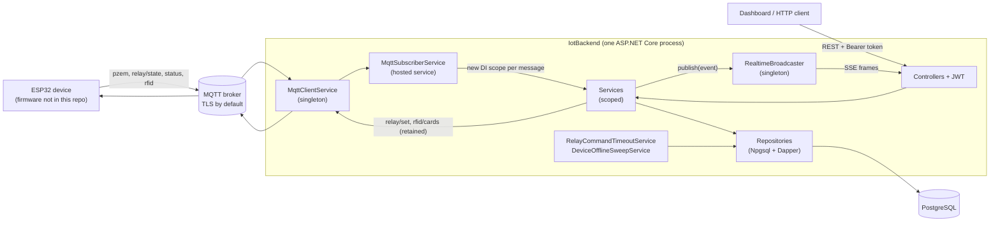
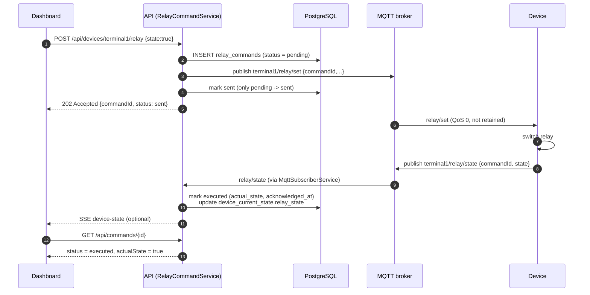
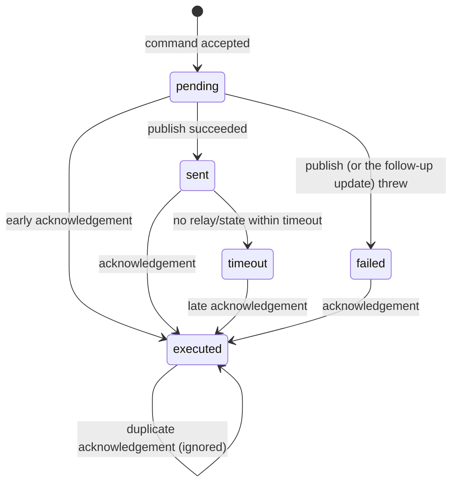
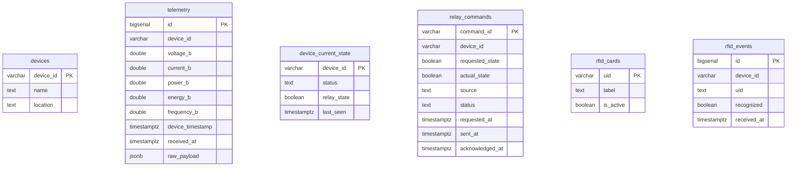

# Architecture

This page describes how the backend is put together, based on the code in `IotBackend/`.

## Components

| Layer | Folder | Responsibility |
|---|---|---|
| Controllers | `Controllers/` | HTTP only: input checks, status codes. No SQL, no MQTT. |
| Services | `Services/` | Business rules: payload parsing, command lifecycle, timestamp normalisation, broadcasting. |
| Repositories | `Repositories/` | All SQL. Parameterised queries written by hand; Dapper maps rows to objects. |
| Background services | `BackgroundServices/` | MQTT subscriber loop, command timeout sweep, device offline sweep. |
| Infrastructure | `Infrastructure/` | MQTT client wrapper, schema initialiser, `.env` loader, SSE broadcaster, startup config validation. |
| Models / Contracts | `Models/`, `Contracts/` | Internal records and MQTT payloads vs. DTOs returned by the API. |

### Dependency-injection lifecycle

`NpgsqlDataSource`, `MqttClientService` and `RealtimeBroadcaster` are singletons. Repositories and
services are scoped. A hosted service is effectively a singleton and must not hold scoped services,
so `MqttSubscriberService` creates a scope **per incoming MQTT message** through
`IServiceScopeFactory`, resolves the service, and disposes the scope afterwards. The same service
classes therefore serve both entry points (HTTP and MQTT), so business rules live in one place.

## Relay command lifecycle

The central design rule: **publishing a command is not the same as the device executing it.** The
backend records the command, publishes it, and only calls it `executed` after the device
acknowledges it and reports a relay state associated with the same `commandId`.

Each step proves something different, and the backend distinguishes them:

| Step | What it shows | Tracked as |
|---|---|---|
| MQTT message published | The backend handed the message to the broker | `sent` |
| MQTT message potentially received | Not observable by the backend (QoS 0, no delivery receipt) | nothing |
| Device acknowledgement | The device answered with the same `commandId` | `executed` |
| Device-reported state | The relay state the firmware reports | `actual_state` |
| Physically measured relay contact | **Not demonstrated by this backend** | nothing |

Rules enforced in SQL (`RelayCommandRepository`) rather than in application code:

- `MarkSent` only moves `pending → sent`. If the device acknowledged *before* this write
  (possible because the publish happens first), the row stays `executed`; `sent_at` is still filled.
  This race was identified during portfolio refinement and is covered by regression tests.
- `MarkExecuted` is applied once; duplicate acknowledgements do not overwrite the first
  `actual_state` / `acknowledged_at`.
- `MarkFailed` only applies to `pending`/`sent`; the timeout sweep only touches `sent`. A confirmed
  command is never downgraded.
- A late acknowledgement after `timeout` or `failed` is accepted: if the device says it switched,
  that is the better information.

State changes **not** initiated from the dashboard (RFID tap, boot) arrive as `relay/state`
without a `commandId`. They are stored as already-`executed` rows with a synthetic id
`"{source}-{guid}"`, so the history shows every relay change.

## Device availability

Two mechanisms work together:

1. **Status topic** — the device can publish an explicit `online`/`offline` status on
   `{deviceId}/status`, and the backend updates `device_current_state.status`. An MQTT Last Will,
   if the firmware configures one, lets the broker publish `offline` after an unexpected
   disconnection. Whether the firmware sets a Last Will is a device-side matter and is not
   verified in this repository.
2. **Inactivity sweep** — `DeviceOfflineSweepService` marks a device `offline` if its `last_seen`
   is older than `DeviceOffline:OfflineThresholdSeconds` (default 165 s), i.e. when no relevant
   message has arrived. This also covers a device that stays connected but goes silent, which no
   Last Will would report. Telemetry, `online` status and relay-state messages refresh `last_seen`.

The sweep updates the database only; it does not push an SSE event.

## Data model

(`device_current_state` also stores the latest measurements; only the key columns are shown.)

- `telemetry` is append-only history (one row per message, raw payload kept as JSONB).
  `device_current_state` is one merged row per device fed by telemetry, relay state and status.
- `relay_commands.command_id` is `VARCHAR`, not `UUID`, because device-initiated rows use
  synthetic ids.
- There are **no foreign keys**. This is a proof-of-concept design trade-off, not a technical
  limitation: telemetry is written before the `devices` row is registered automatically, so adding
  foreign keys would require registering the device first (a different write order and a decision
  about unknown devices).
- The schema is a single idempotent script (`Database/001_initial_schema.sql`) run on startup. It
  creates tables but does not migrate them.

## Time handling

Timestamps are stored as `timestamptz` in UTC. Device clocks are never trusted for ordering:
`received_at` is the server time used for history queries. Legacy device timestamps without an
offset are interpreted as UTC+7 (the timezone the original firmware used) and converted. Npgsql
only accepts `DateTimeOffset` values with offset zero for `timestamptz`, so parsed values are
normalised to UTC before they reach the database.

## Configuration and startup

`StartupConfigurationValidator` runs before any service is built and reports every missing or
invalid required value in one error message (without printing secret values): PostgreSQL
connection string, MQTT host and port, auth username, a password hash in ASP.NET Core Identity
format, and a JWT signing key of at least 32 bytes. A `.env` file next to the project is loaded
for local development; real environment variables take precedence.
`dotnet run --no-launch-profile --project IotBackend -- hash-password` generates the password hash.

Nested keys use a double underscore (`Mqtt__Host` is `Mqtt:Host`). `.env` files are git-ignored;
start from `.env.example` (Docker Compose) or `IotBackend/.env.example` (`dotnet run`).

| Variable | Required | Notes |
|---|---|---|
| `ConnectionStrings__Postgres` | yes | Npgsql connection string (Compose builds it from `POSTGRES_PASSWORD`) |
| `Mqtt__Host` | yes | broker host |
| `Mqtt__Port` | no (8883) | |
| `Mqtt__Username`, `Mqtt__Password` | broker-dependent | |
| `Mqtt__UseTls` | no (`true`) | set `false` only for a local broker on loopback |
| `Auth__Username` | yes | single shared dashboard account |
| `Auth__PasswordHash` | yes | output of the `hash-password` command |
| `Auth__JwtSigningKey` | yes | at least 32 bytes of random text |
| `Auth__TokenLifetimeHours` | no (24) | |
| `Relay__CommandTimeoutSeconds` | no (30) | |
| `DeviceOffline__OfflineThresholdSeconds` | no (165) | tune to the device's publishing interval |
| `HttpsRedirection__Enabled` | no | defaults to on in Development, off otherwise |
